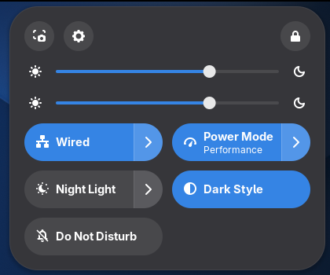
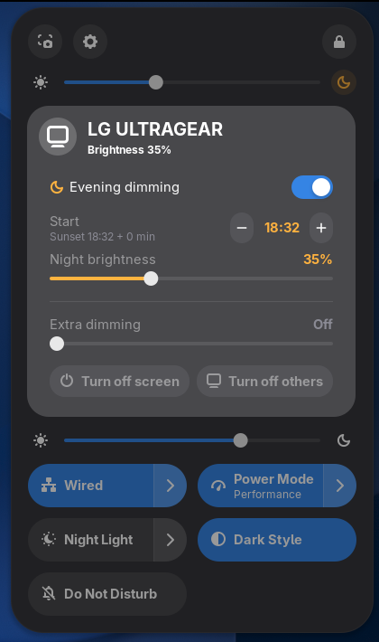
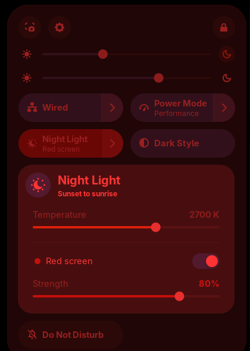

# Brightness+

A brightness slider for every monitor, right inside GNOME Quick Settings — next to the volume slider, in the same native look.
External monitors are controlled over DDC/CI ([ddcutil](https://www.ddcutil.com/)), laptop screens through the backlight.

Works on GNOME Shell 46, 47, 48, 49, 50 and 51.

<p>
  
  
  
</p>

## Features

- **One thin slider per monitor** in Quick Settings. Hover to see the monitor's name and level.
  Left of the slider: brightness icon, monitor number (1, 2, 3…) or short name (LG, VS…).
- **Evening dimming** (the moon button): brightness slowly goes down after sunset — or at a fixed time — and comes back in the morning.
  Start time (sunset ± minutes) and night brightness per monitor, transition length in the preferences.
- **Sunset from your location, without permissions**: like Night Light, it uses the location GNOME already keeps for Night Light,
  otherwise your time zone (follows you when the time zone changes). A manual location can be set. Nothing is sent anywhere.
- **Extra dimming** per monitor: software dimming for when the monitor is already at its lowest. Off by default — it costs some image quality.
- **Turn off screen / Turn off others**: fully black or lowest light. Moving the mouse onto a turned off screen brings it back.
- **Night Light menu**: colour temperature and **Red screen** — removes all blue and green light at night, with adjustable strength.
  Can follow Night Light's schedule automatically.

Available in 18 languages.

## Fast by design

The well known DDC extensions call ddcutil for every slider movement, which makes the desktop stutter. Brightness+ does not:

- every ddcutil call is an asynchronous subprocess; nothing ever blocks GNOME Shell
- one write at a time per monitor; newer values replace the waiting one (dragging a slider from end to end = a handful of writes)
- a value that is already set is never written again; evening dimming writes only when the visible percentage changes (≈ once a minute)
- no polling: timers sleep until the next change, the monitor list is cached on disk and refreshed in the background
- software dimming and red screen are only attached while used

## Requirements

- `ddcutil` (for external monitors), and access to `/dev/i2c-*`:

  ```sh
  sudo usermod -aG i2c $USER   # then log out and back in
  ```
  Some distributions also need the module: `sudo modprobe i2c-dev` (make it permanent with `echo i2c-dev | sudo tee /etc/modules-load.d/i2c-dev.conf`).
- Without ddcutil, sliders of external monitors fall back to software dimming.

Disable other brightness extensions (e.g. *Display Brightness ddcutil*, *Soft Brightness Plus*) — they control the same things.

## Install

From [extensions.gnome.org](https://extensions.gnome.org/) — or from source:

```sh
git clone https://github.com/uuRCnn/brightness-plus.git
cd brightness-plus
tools/build.sh --install
# Wayland: log out and back in, then
gnome-extensions enable brightness-plus@dukha
```

## Development

```sh
npm install        # eslint
npm run lint
tools/run-test.sh  # isolated headless GNOME Shell + fake ddcutil, screenshots in build/test
```

The test never touches the running session, your settings or your real monitors.

## License

GPL-2.0-or-later — © 2026 Dukha
