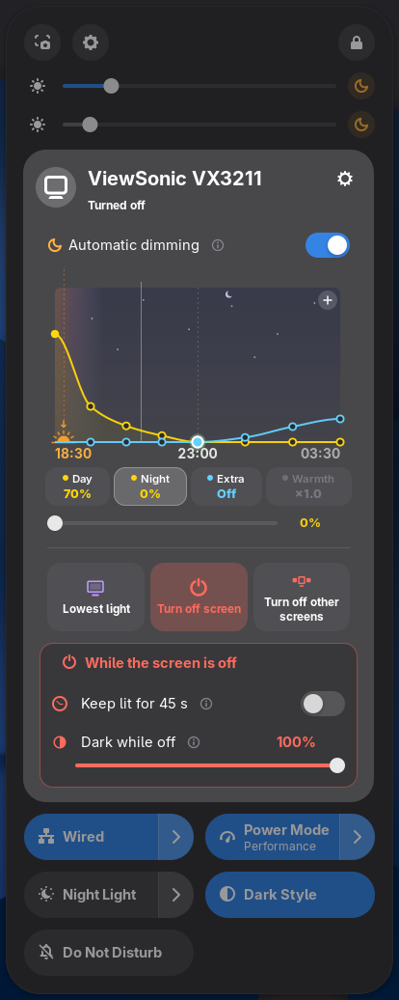

# Auto Brightness+

A brightness slider for every monitor, right inside GNOME Quick Settings — next to the volume slider, in the same native look.
External monitors are controlled over DDC/CI ([ddcutil](https://www.ddcutil.com/)), laptop screens through the backlight.

Works on GNOME Shell 46, 47, 48, 49, 50 and 51.

<p>
  
  
  
</p>

## Features

- **One thin slider per monitor** in Quick Settings. Hover to see the monitor's name and level.
  Left of the slider: brightness icon, monitor number (1, 2, 3…) or short name (LG, VS…).
- **Automatic dimming** (the moon button), per monitor. From sunset — or a set time — brightness goes down the way the
  light outside does: quickly in the first hour, then slower. It comes back in the morning.
  - Out of the box the main monitor goes down to 10 % in four hours. The other monitors go to 0 % a little later, and get
    some extra dimming late at night.
  - The graph shows the real sky at your location: day, sunset, twilight, night, ☾ at midnight. The setting sun marks
    the sunset, and the orange bar shows when GNOME's Night Light is on.
  - Drag the points to shape the evening. The big point also sets how long it takes.
- **A simple menu**: one pill per value (Day, Night, Extra, Warmth, Red) and one slider for the pill you pick.
  Prefer a slider for everything? Switch to the *Detailed* menu in the preferences.
- **Buttons that run by themselves**: press + on the graph to put *Lowest light*, *Turn off screen* or
  *Turn off other screens* at a time of the evening. Out of the box the main monitor turns the others off three hours
  after sunset. *Back to normal in the morning* undoes them.
- **Reset arrows** next to every slider bring back the default, and only show up when something was changed.
- **Sunset from your location, without permissions**: the location GNOME already keeps for Night Light,
  otherwise your time zone. A manual location can be set. Nothing is sent anywhere.
- **Per monitor Night light ×0–×2 and Red light ×0–×2**: how strong GNOME's Night Light and the red screen are on that
  monitor. They go through the monitor's own colour table, like Night Light itself. **Extra dimming** darkens further
  when the monitor is already at its lowest.
- **Lowest light** with one click. On the main monitor it keeps a little more light, so a misclick is easy to undo.
- **Turn off screen / Turn off other screens**:
  - Clicks and typing always reach the apps on a turned off screen.
  - The monitor stays at its lowest light, and only a black layer fades in and out. It lights up while the mouse is on it
    and goes dark again when the mouse leaves: smooth, with no monitor writes at all.
  - Under the button you set *Keep lit for 45 s* (after the mouse leaves) and *Dark while off*. That is 100 % when you
    turn a screen off by hand, and 25 % when the evening does it.
- **Claude Code is done**: connect it in the preferences (one button, no account needed). When Claude finishes or waits
  for your answer, you get a notification, and a turned off screen with its terminal lights up for 45 s.
  Other programs can do the same with the terminal bell, e.g. `make ; printf "\a"`.
- **Night Light menu**: colour temperature and **Red screen**, which removes blue and green light at night, with
  adjustable strength.
- The menu scrolls when it is taller than the screen (laptops, 1080p).

Available in 18 languages.

## Fast by design

The well known DDC extensions call ddcutil for every slider movement, which makes the desktop stutter. Auto Brightness+ does not:

- every ddcutil call is an asynchronous subprocess; nothing ever blocks GNOME Shell
- one write at a time per monitor; newer values replace the waiting one (dragging a slider from end to end = a handful of writes)
- a value that is already set is never written again; evening dimming writes only when the visible percentage changes
- no polling: timers sleep until the next change (the mouse position is checked only while a screen is turned off), the monitor list is cached on disk and refreshed in the background
- a turned off screen is never written to while the mouse comes and goes: only a black layer fades
- software dimming is a plain black layer, red screen and the per monitor Night Light go through the monitors’ colour tables (no drawing, no GPU cost); both exist only while used

## Requirements

- `ddcutil` (for external monitors), and access to `/dev/i2c-*`:

  ```sh
  sudo usermod -aG i2c $USER   # then log out and back in
  ```
  Some distributions also need the module: `sudo modprobe i2c-dev` (make it permanent with `echo i2c-dev | sudo tee /etc/modules-load.d/i2c-dev.conf`).
- Without ddcutil, sliders of external monitors fall back to software dimming.

Disable other brightness extensions (e.g. *Display Brightness ddcutil*, *Soft Brightness Plus*) — they control the same things.

## Claude Code by hand

The preferences button adds two hooks to `~/.claude/settings.json` (a backup is kept). The same by hand:

```json
"hooks": {
  "Stop": [{"hooks": [{"type": "command", "command": "gdbus call --session --dest org.gnome.Shell --object-path /org/gnome/Shell/Extensions/AutoBrightnessPlus --method org.gnome.Shell.Extensions.AutoBrightnessPlus.Notify done $PPID >/dev/null 2>&1 || true"}]}],
  "Notification": [{"matcher": "permission_prompt|elicitation_dialog", "hooks": [{"type": "command", "command": "gdbus call --session --dest org.gnome.Shell --object-path /org/gnome/Shell/Extensions/AutoBrightnessPlus --method org.gnome.Shell.Extensions.AutoBrightnessPlus.Notify ask $PPID >/dev/null 2>&1 || true"}]}]
}
```

## Install

From [extensions.gnome.org](https://extensions.gnome.org/) — or from source:

```sh
git clone https://github.com/uuRCnn/auto-brightness-plus.git
cd auto-brightness-plus
tools/build.sh --install
# Wayland: log out and back in, then
gnome-extensions enable auto-brightness-plus@dukha
```

## Development

```sh
npm install        # eslint
npm run lint
tools/run-test.sh  # isolated headless GNOME Shell + fake ddcutil, screenshots in build/test
BP_MONITORS="1366x768 1280x800" tools/run-test.sh build/test-768   # small screens
# README screenshots
BP_TEST_SCRIPT=$PWD/tools/readme-shots.js BP_MONITORS="1600x1300 1280x800" tools/run-test.sh build/shots && tools/readme-shots.py
```

The test never touches the running session, your settings or your real monitors.

## License

GPL-2.0-or-later — © 2026 Dukha
